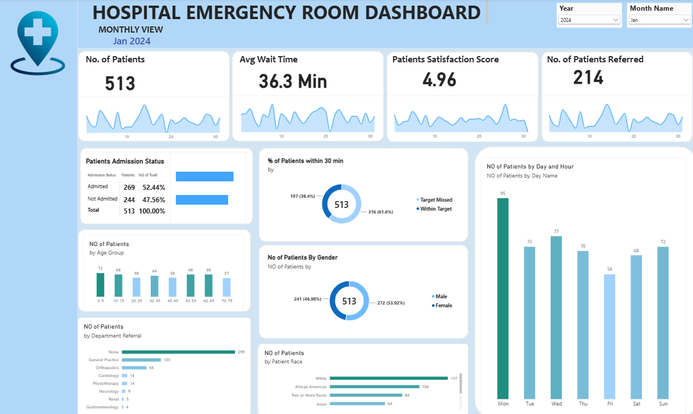

# Hospital Emergency Room Dashboard

An interactive dashboard that tracks patient flow, wait times, admissions and referrals in a hospital emergency room.

## Business Problem
A hospital emergency room needs to know how many patients it handles, how long they wait, how many are admitted or referred, and which days are the busiest, so that it can plan staff and reduce waiting time.

## Dashboard Preview

## What the Dashboard Shows
- Number of patients, average wait time, patient satisfaction score and patients referred
- Admitted vs not admitted patients
- Percentage of patients seen within 30 minutes
- Patients by age group, gender, race and department referral
- Patients by day of the week
- Year and month filters (the view above is January 2024)

## Key Findings (January 2024)
- 513 patients visited the emergency room, with an average wait time of 36.3 minutes.
- 61.6% of patients missed the 30-minute target.
- 52.44% of patients were admitted.
- 41.7% of patients were referred to a department, mostly General Practice and Orthopedics.
- Monday was the busiest day (95 patients) and Friday the quietest (59 patients).

## Tools
- Power BI

## Project Status
| Deliverable | Status |
|---|---|
| Dashboard screenshot | Included |
| Power BI file (.pbix) | To be added |
| Dataset | To be added |

## Author
**Shoaib Shaikh**
MCA Graduate | Aspiring Data Analyst
[GitHub](https://github.com/Shoaibs-10)
